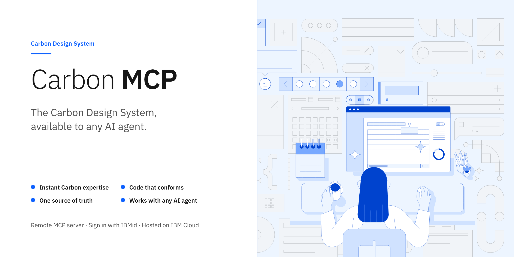

<p align="center"></p>

# Carbon MCP

**The Carbon Design System, available to any AI agent.**

Carbon MCP is a hosted server that gives AI agents direct access to Carbon's
components, icons, charts and documentation through MCP, the open Model Context
Protocol standard for connecting AI applications to external tools and data. It
runs on IBM Cloud, so any MCP client can connect with a URL and an IBMid
sign-in. This repository is where you report issues, request features and get
the Carbon Builder skill.

<p align="center">
  <a href="#connect"><strong>Connect</strong></a> ·
  <a href="#pair-it-with-the-carbon-builder-skill"><strong>Carbon Builder skill</strong></a> ·
  <a href="#tools"><strong>Tools</strong></a> ·
  <a href="#coverage"><strong>Coverage</strong></a> ·
  <a href="https://github.com/carbon-design-system/carbon-mcp/issues/new/choose"><strong>Report an issue</strong></a>
</p>

<p align="center"><a href="TERMS_OF_USE.md">Terms of Use for the hosted service</a> · <a href="public/skills/carbon-builder/SKILL.md">Apache-2.0 for the Carbon Builder skill</a></p>

---

## Why Carbon MCP

Carbon MCP makes any agentic AI application an instant expert in the Carbon
Design System, so teams deliver consistent, high-quality user experiences with
greater speed.

| Benefit                           | What it means                                                                                                                                    |
| --------------------------------- | ------------------------------------------------------------------------------------------------------------------------------------------------ |
| **Direct access to Carbon**       | AI agents query the Carbon Design System for the context they need: colors, typography, component source, usage guidelines.                      |
| **Better generated code**         | Code examples and documentation from Carbon MCP let AI tools generate high-fidelity Carbon UI code that follows design and development practice. |
| **One answer for the whole team** | Designers, developers and PMs get consistent answers and examples from a shared source of truth, which reduces drift and rework.                 |

## Connect

The Carbon MCP server is hosted remotely at
`https://mcp.carbondesignsystem.com/mcp`. Add it to your client as a remote MCP
server and sign in with your IBMid when asked.

Clients that read an `mcp.json` file use this minimal configuration:

```json
{
  "mcpServers": {
    "carbon-mcp": {
      "type": "streamable-http",
      "url": "https://mcp.carbondesignsystem.com/mcp",
      "oauth": true,
      "alwaysAllow": []
    }
  }
}
```

| Client                                                 | Setup                                                                                                                           |
| ------------------------------------------------------ | ------------------------------------------------------------------------------------------------------------------------------- |
| IBM Bob                                                | [Onboarding: IBM Bob](https://www.carbondesignsystem.com/getting-started/carbon-mcp/onboarding-and-setup#ibm-bob)               |
| Claude Desktop                                         | [Onboarding: Claude Desktop](https://www.carbondesignsystem.com/getting-started/carbon-mcp/onboarding-and-setup#claude-desktop) |
| Cursor                                                 | [Onboarding: Cursor](https://www.carbondesignsystem.com/getting-started/carbon-mcp/onboarding-and-setup#cursor)                 |
| Figma Make                                             | [Onboarding: Figma Make](https://www.carbondesignsystem.com/getting-started/carbon-mcp/onboarding-and-setup#figma-make)         |
| Claude Code, VS Code, GitHub Copilot and other clients | [Onboarding: Other clients](https://www.carbondesignsystem.com/getting-started/carbon-mcp/onboarding-and-setup#other-clients)   |
| Clients without OAuth                                  | [Token and session ID](https://www.carbondesignsystem.com/getting-started/carbon-mcp/onboarding-and-setup#token-and-session-id) |

The full [onboarding and setup guide](https://www.carbondesignsystem.com/getting-started/carbon-mcp/onboarding-and-setup)
covers what to have [before you begin](https://www.carbondesignsystem.com/getting-started/carbon-mcp/onboarding-and-setup#before-you-begin),
the [prerequisites](https://www.carbondesignsystem.com/getting-started/carbon-mcp/onboarding-and-setup#prerequisites),
[connecting to the server](https://www.carbondesignsystem.com/getting-started/carbon-mcp/onboarding-and-setup#connect-to-the-carbon-mcp-server)
and every client above.

### Token and session ID

If your client does not support OAuth discovery, you can authenticate with a
token and session ID instead.

1. Generate a [token and session ID](https://mcp.carbondesignsystem.com/mcp/auth/ibmid/web).
2. Copy your credentials and add them to your Carbon MCP configuration.

## Pair it with the Carbon Builder skill

[Carbon Builder](public/skills/carbon-builder) is a portable AI skill that turns
an agent into an expert Carbon Design System engineer. It retrieves live
component examples, variants, props and documentation from the Carbon MCP
server, generates Carbon React and Web Components code, and builds Carbon Charts
across every supported framework.

The server supplies the facts; the skill tells the agent when to ask for them
and how to turn the answers into working code. Together they produce better
results than either alone.

Install it with the skills CLI, choosing the line for your agent:

```bash
npx skills add https://github.com/carbon-design-system/carbon-mcp/tree/main/public/skills/carbon-builder -g -a bob
npx skills add https://github.com/carbon-design-system/carbon-mcp/tree/main/public/skills/carbon-builder -g -a claude-code
npx skills add https://github.com/carbon-design-system/carbon-mcp/tree/main/public/skills/carbon-builder -g -a cursor
npx skills add https://github.com/carbon-design-system/carbon-mcp/tree/main/public/skills/carbon-builder -g -a codex
npx skills add https://github.com/carbon-design-system/carbon-mcp/tree/main/public/skills/carbon-builder -g -a github-copilot
npx skills add https://github.com/carbon-design-system/carbon-mcp/tree/main/public/skills/carbon-builder -g -a gemini-cli
```

The CLI supports many more agents; see [skills.sh](https://skills.sh). The
skill has its own page at
[skills.sh/carbon-design-system/carbon-mcp/carbon-builder](https://www.skills.sh/carbon-design-system/carbon-mcp/carbon-builder).

To install without the CLI, download
[`carbon-builder.zip`](public/skills/carbon-builder.zip), unzip it, and copy the
`carbon-builder/` folder to your client's skills location. The
[skill README](public/skills/carbon-builder/README.md) lists the path for each
client, and the onboarding guide walks through it in
[Set up your AI client and install the Carbon Builder skill](https://www.carbondesignsystem.com/getting-started/carbon-mcp/onboarding-and-setup#set-up-your-ai-client-and-install-the-carbon-builder-skill).

## Tools

| Tool          | What it returns                                                                                                                   |
| ------------- | --------------------------------------------------------------------------------------------------------------------------------- |
| `code_audit`  | A check of your code against Carbon guidelines covering design tokens, component usage, accessibility, layout and best practices. |
| `code_search` | Carbon React and Web Components code examples, icons and pictograms, including complete example application files.                |
| `docs_search` | Carbon Design System and IBM Products documentation, such as component guidance, usage, accessibility and reference material.     |
| `get_charts`  | Carbon Charts code examples for React, Angular, Vue, Svelte, Vanilla JS and HTML.                                                 |
| `labs_search` | Code examples, props, events and usage docs for Carbon Labs experimental components.                                              |

## Coverage

Carbon MCP continues to evolve. Current coverage:

| Corpus                      | Examples                                                        | What is indexed                                                                                                     |
| --------------------------- | --------------------------------------------------------------- | ------------------------------------------------------------------------------------------------------------------- |
| `@carbon/react`             | Button, Tabs, TextInput                                         | Code examples and documentation, multiple variants per component, complete props and imports                        |
| `@carbon/web-components`    | button, tabs, text-input                                        | Code examples and documentation, multiple variants per component, complete props and imports                        |
| Carbon for IBM Products     | Tearsheets, PageHeader                                          | Code examples and documentation, multiple variants per component, complete props and imports                        |
| Carbon Icons and Pictograms | Settings, User, UserAvatarFilled                                | Code examples and documentation, usage                                                                              |
| `@carbon/ai-chat`           | basic, custom-element, history                                  | Code examples and documentation, full code examples, complete props and imports                                     |
| `@carbon/charts`            | Chart types, with links to demos                                | Chart type descriptions, links to demos, full code examples, complete props and imports                             |
| `@carbon-labs/*`            | React: AnimatedHeader, Processing, Resizer, UIShell, What's New | Code examples and documentation for preview candidates, multiple variants per component, complete props and imports |

The [Concepts page](https://www.carbondesignsystem.com/getting-started/carbon-mcp/concepts#content-coverage)
describes the content in more detail.

## Documentation

| Document                                                                                                   | Covers                                                                                                         |
| ---------------------------------------------------------------------------------------------------------- | -------------------------------------------------------------------------------------------------------------- |
| [Overview](https://www.carbondesignsystem.com/getting-started/carbon-mcp/overview)                         | Carbon MCP overview and key benefits                                                                           |
| [Concepts](https://www.carbondesignsystem.com/getting-started/carbon-mcp/concepts)                         | The Carbon MCP tools and content coverage                                                                      |
| [Onboarding and setup](https://www.carbondesignsystem.com/getting-started/carbon-mcp/onboarding-and-setup) | Authentication, connecting common MCP clients, installing the Carbon Builder skill                             |
| [Prompts](https://www.carbondesignsystem.com/getting-started/carbon-mcp/prompts)                           | Prompting guidance and best practices                                                                          |
| [Token conservation](https://www.carbondesignsystem.com/getting-started/carbon-mcp/token-conservation)     | Keeping AI workflows fast and cost-efficient by cutting unnecessary context and responses                      |
| [Terms of Use](TERMS_OF_USE.md)                                                                            | Terms for the IBM Cloud-hosted Carbon MCP service                                                              |
| [Support](SUPPORT.md)                                                                                      | Getting help                                                                                                   |
| [Code of conduct](.github/CODE_OF_CONDUCT.md)                                                              | How we expect everyone to behave in this project                                                               |

---

## Issues and support

[Open an issue](https://github.com/carbon-design-system/carbon-mcp/issues/new/choose)
to report a bug, request a feature or ask for help. Templates guide each one.
